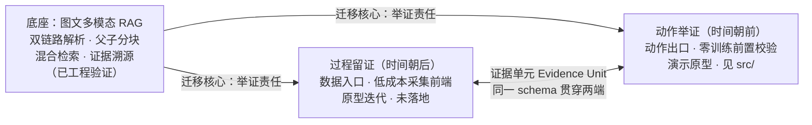
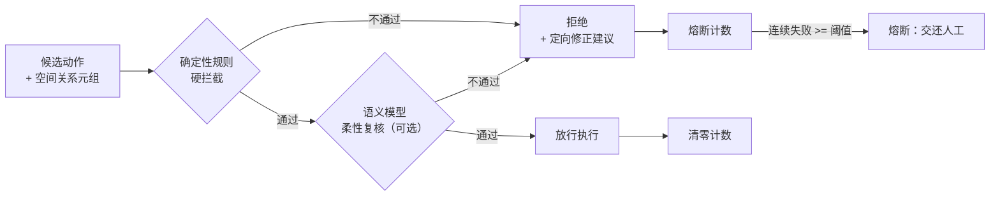

# 行之有据 · Evidence-Based Embodied AI

> 把软件世界成熟的"举证责任"思想搬进物理世界：**朝后看，过程留证**（数据入口）；**朝前看，动作举证**（动作出口）。

   

具身智能落地有两道坎：数据昂贵、轻量化规划易出错。二者共享一个被忽视的瓶颈：**物理世界的"经验"未被结构化、证据化**。本仓库以已工程跑通的图文多模态 RAG 为底座，提炼"一个底座、两个落点"框架：

- **过程留证**：在数据入口把人的操作沉淀为任务级示教数据（低成本采集前端）；
- **动作举证**：在动作出口为零训练机器人规划做前置语义校验（本仓库含可运行的规则校验器）。

本文不做算法创新，只讲工程范式、能力边界与上手路径。完整论述见 [docs/01-总纲-行之有据.md](docs/01-总纲-行之有据.md)。

## 架构总览



校验器像施工现场的安全员：不替工人干活、不做力学计算，只拿清单追问——"你说墙后有杯子，亲眼看见了吗？没看见就不许伸手。"



## 当前成熟度（诚实声明）

| 模块 | 状态 | 说明 |
|---|---|---|
| 底座：图文多模态 RAG | 已工程验证 | 四件工程件（双链路解析、父子分块、混合检索、证据溯源）在真实项目跑通 |
| 采集前端（过程留证） | 方案设计 | 完成原型迭代与成熟度分析，此后未继续开发；帧差抽帧、三重绑定仍是设计 |
| 前置校验器（动作举证） | 演示原型 + 仿真初测 | `src/` 可运行、有单测；MuJoCo 168 个遮挡场景已跑出拦截率/误拦率，但感知侧是误差模型模拟，**非真实 VLM 实测** |

## Boundaries & Limitations

- 本框架目前仅停留在**软件侧语义推演**，不包含三维重建、物理碰撞检测、运动学求解；毫米级误差与动力学碰撞遇到即熔断，交还几何/控制模块；
- 零训练规则校验器的拦截率、误报率**尚无真实 VLM 实测**：仿真实验（[docs/03](docs/03-校验层消融-仿真报告.md)）的感知侧是误差模型模拟，数字只说明规则层的行为边界，不构成安全承诺；
- 采集前端三条链路仍是设计，**没有真机、没有实测数据**；
- 本路线不覆盖端到端 VLA、纯三维几何、传统控制路线；
- 原型成熟度不等于产业级可靠性。

## 快速开始

零第三方依赖，Python >= 3.8：

```bash
# 运行演示：拦截"遮挡仍抓取 / 参考系混淆 / 证据不足强行规划"三类典型错误
python src/semantic_checker/demo.py

# 运行单元测试（零依赖，标准库即可）
python -m unittest discover -s src/semantic_checker/tests -t src -v
# 或（装有 pytest 时）
pytest src/semantic_checker/tests -q
```

阶段二仿真实验（需 `pip install -r requirements-sim.txt`，CPU 即可）：

```bash
python src/mujoco_eval/run.py            # 168 个遮挡场景批量评估 -> experiments/
python src/mujoco_eval/run.py --render   # 额外渲染遮挡/可见示例图 -> assets/sim/
```

示例——拦截"杯子被书本挡住仍规划去拿"：

```python
from semantic_checker.schema import ActionCandidate, SpatialRelation
from semantic_checker.checker import SemanticChecker

# 规划器候选动作："抓取杯子"，但证据里杯子被书本遮挡、且置信度未标注
action = ActionCandidate(
    action="grasp",
    target="杯子",
    evidence=[
        SpatialRelation(subject="杯子", relation="occluded", object="书本",
                        reference_frame="table", confidence=None, observed=None),
    ],
)

verdict = SemanticChecker().check(action)
print(verdict.passed)      # False
print(verdict.reason)      # 目标被遮挡，禁止抓取
print(verdict.suggestion)  # 建议先移开遮挡物「书本」，再确认可见后重新规划
```

## 项目结构

```text
.
├── README.md                    # 门面（本文件）
├── LICENSE                      # MIT
├── docs/                        # 长篇文档
│   ├── 01-总纲-行之有据.md       # 系列第一篇：完整论述（含 20 篇参考文献）
│   ├── 02-数据侧对照.md          # 占位符，第二篇开展后替换
│   ├── 03-校验层消融-仿真报告.md  # 第三篇第一版：MuJoCo 遮挡场景消融
│   ├── terminology.md           # 术语表（RAG / VLA / CBF / 阶段幻觉……）
│   └── references.md            # 参考文献一览表
├── assets/                      # 图片
│   ├── framework.png            # 图 1 框架总览图
│   ├── positioning-map.png      # 图 2 安全机制二维定位图
│   └── sim/                     # 仿真示例图（遮挡 / 可见）
├── experiments/                 # 实验结果（CSV + 自动生成表）
├── requirements-sim.txt         # 阶段二依赖（mujoco / numpy / Pillow）
├── src/
│   ├── semantic_checker/        # 阶段一：零训练规则校验器（可运行）
│   │   ├── schema.py            # 空间关系元组 / 动作候选
│   │   ├── parser.py            # 文本模拟：自由文本 -> 结构化元组（阶段一）
│   │   ├── rules.py             # 确定性规则：遮挡 / 参考系 / 证据充分性 / 置信度
│   │   ├── checker.py           # 双轨校验 + 定向修正 + 熔断器
│   │   ├── demo.py              # 六个案例演示（含熔断）
│   │   └── tests/               # 单元测试（19 个）
│   └── mujoco_eval/             # 阶段二：MuJoCo 仿真评估
│       ├── scene.py             # 桌面 / 杯子 / 书本 MJCF 场景
│       ├── geometry.py          # 射线几何真值 + 相机布置
│       ├── perception.py        # 感知基线（Oracle / NoisyVLM 误差模型）
│       ├── evaluate.py          # 消融网格与指标
│       ├── run.py               # 命令行入口
│       └── tests/               # 几何真值冒烟测试
└── .github/ISSUE_TEMPLATE/      # Issue 模板（Bug 反馈 / 知识飞轮）
```

## Roadmap

进度同步维护在 GitHub Projects 看板（Todo / In Progress / Done 三列）：
> 看板地址：[Roadmap 看板](https://github.com/users/Fan-Ruixuan/projects/2/views/1?layout_template=board)

| 篇 | 主题 | 核心工程问题 | 状态 |
|---|---|---|---|
| 一 | 总纲：经验证据化的工程范式 | —— | 本仓库发布 |
| 二 | 数据侧对照 | 证据化处理能否提升下游规划成功率？ | 计划中 |
| 三 | 校验层消融 | 规则与模型的分工、熔断阈值、同期对比 | 进行中（仿真 v1 已跑通，待接真实 VLM） |
| 四 | 产品化调研 | 低打断交互对记录意愿的真实影响 | 计划中 |
| 五 | 飞轮方向 | 跨路线语义对齐 + 难例回流 | 计划中 |

代码侧里程碑：

- **阶段一（已完成）**：Python 文本模拟——自由文本指令 -> 空间元组 -> 规则拦截 -> 熔断；
- **阶段二 v1（已完成）**：MuJoCo 桌面遮挡场景批量评估——168 个场景、射线几何真值、误差模型感知基线，输出 TPR/FPR 消融表（[报告](docs/03-校验层消融-仿真报告.md)）；待接入真实 VLM 输出。 

## FAQ / Known Criticisms

**Q1：没有真机，怎么证明这套东西有意义？**
本框架的定位是分层防御中**最便宜的第一道**语义过滤，验证不需要真机：阶段一用文本模拟验证规则逻辑；阶段二已完成 MuJoCo 遮挡场景批量评估（168 个场景、射线几何真值），在"感知完全诚实"的设定下拦截率等于 1-漏检率、误拦率为 0，并量化了自陈质量下降时误拦如何上升（[报告](docs/03-校验层消融-仿真报告.md)）。真机只有在进入几何/控制层时才必需，而那已超出本框架声明的能力边界。

**Q2：为什么不用 MADRA / SafeGate / VIRF 那样的重机制？**
差异不在"谁更安全"——它们保证更强——而在**组织原则的来源**：MADRA 来自辩论理论，SafeGate 来自形式化安全标准，VIRF 来自可验证逻辑；本框架"每个候选动作必须出示空间关系元组作为证据"来自 RAG 举证责任，因而不需要多智能体交互、形式化分解或仿真基建。代价是只给语义级弱保证——它不替代重机制，而是与控制屏障函数、安全强化学习**层叠部署**：弱保证模块便宜拦住低级错误，强保证模块守住底线。

**Q3：规则校验器误报了怎么办？**
承认这是核心风险。设计上的应对有三：规则只拦"人类一眼看出蠢"的语义错误，不碰几何；拦截时必带定向修正建议（"先移开遮挡物"）而非单纯拒绝，规划可低成本改写重试；熔断阈值可配置，宁可"看不清就不动"，把最终裁决权交还人工。仿真初测显示：误拦率对"感知模型是否如实标注字段"极其敏感（诚实度 100% 时 0%，50% 时约 54%）——所以第一优先级不是加规则，而是强制结构化输出。真实 VLM 下的误报率仍待实测（[报告](docs/03-校验层消融-仿真报告.md)）。

**Q4：和 SayCan 的 affordance 打分有什么区别？**
SayCan 在"语言说有用"与"affordance 说可行"之间做概率相乘，依赖一个**学出来的**可供性模型；本框架的规则是**零训练**的确定性检查，且强制要求证据出示"观测性质"（亲眼所见/推测）与参考坐标系——专治主流轻量流水线"VLM 自由描述 + LLM 一次性出动作"里"画面没证据也敢出动作"的问题。二者可叠加：affordance 管可行性，本框架管证据合规。

**Q5："单模型不可自我审查"，校验器自己不也是模型/规则吗？**
校验器是独立于生成模型的**外部确定性检查**，与 IETF Asimov 草案"确定性拒绝名单 + LLM 复核"的双门设计独立同构：规则优先于模型，模型只做柔性复核。它不审查自己，只审查别人。

## 文档导航

- [总纲：行之有据（第一篇完整论述）](docs/01-总纲-行之有据.md)
- [校验层消融：MuJoCo 遮挡场景仿真实验（第三篇 v1）](docs/03-校验层消融-仿真报告.md)
- [术语表：RAG / VLA / CBF / 阶段幻觉 / 证据单元……](docs/terminology.md)
- [参考文献一览（20 篇，行业数据 / 学术 / 法律案例）](docs/references.md)
- [数据侧对照实验设计（占位）](docs/02-数据侧对照.md)
- [校验器模块说明与阶段二计划](src/semantic_checker/README.md)

## 参与

- 发现论述错误、逻辑漏洞 → 提 [Bug report](.github/ISSUE_TEMPLATE/bug_report.yml)；
- 论文线索、行业观察、复现尝试 → 提 [知识飞轮](.github/ISSUE_TEMPLATE/knowledge_flywheel.yml)，本仓库长期沉淀为具身智能证据化知识库；
- 想先聊聊 → GitHub Discussions。

> 探月具身智能社区 · 技术专栏 系列总纲第一篇。记录让好经验不必重来，校验让坏动作不必发生。
