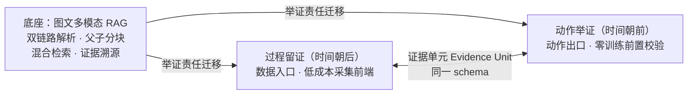
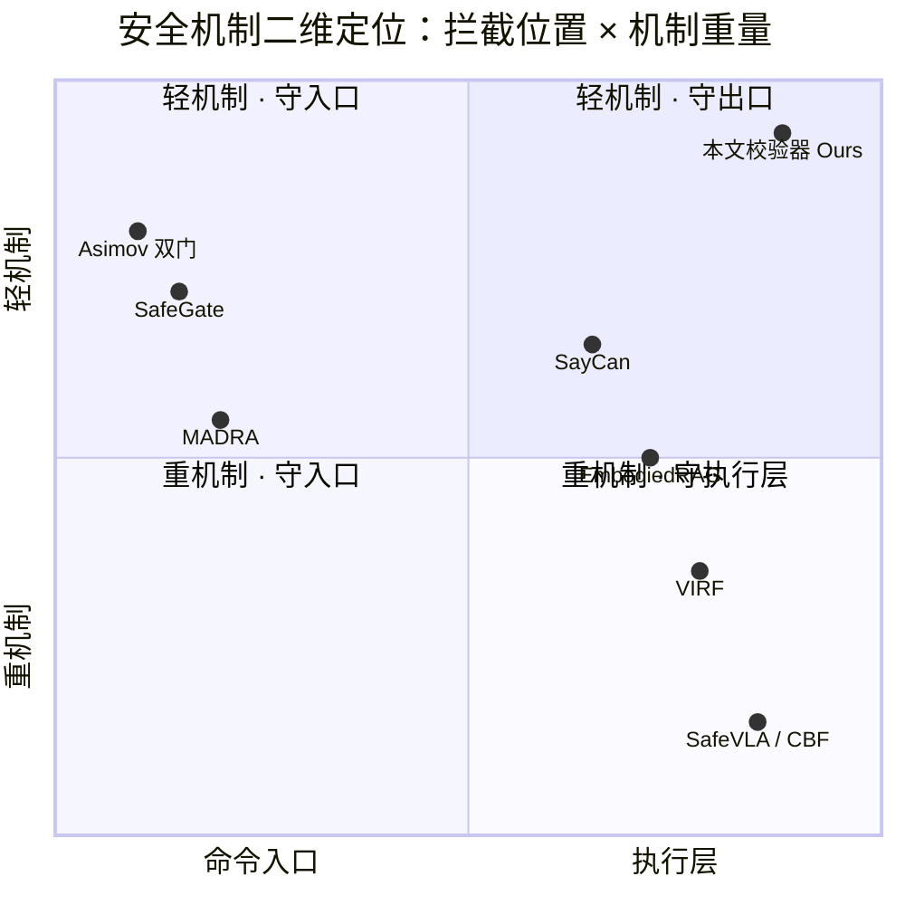
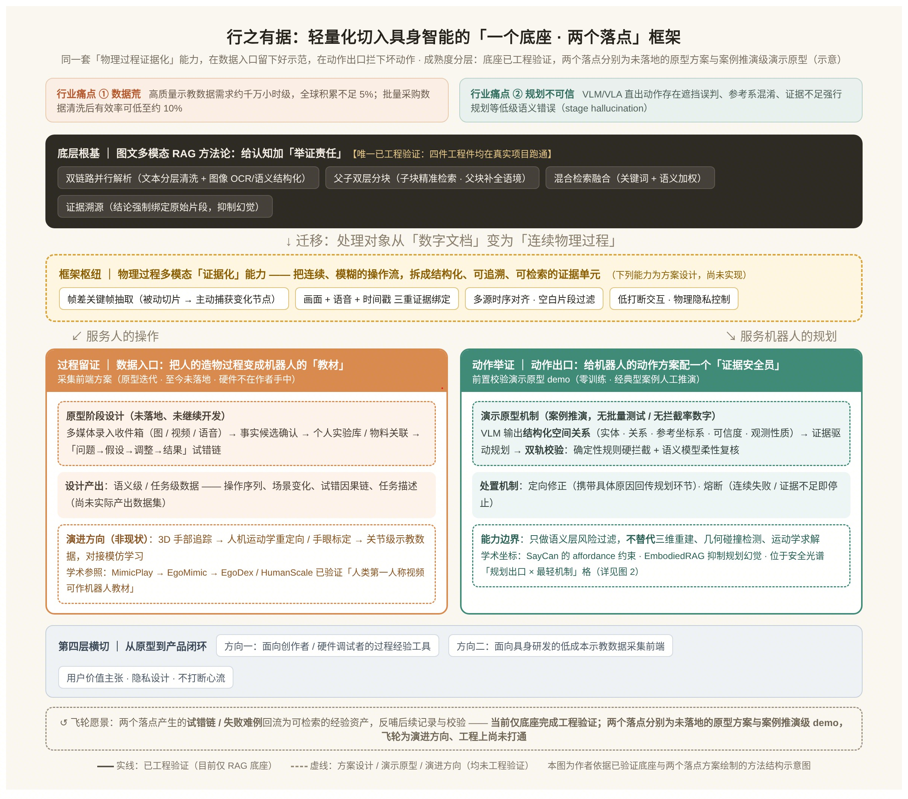
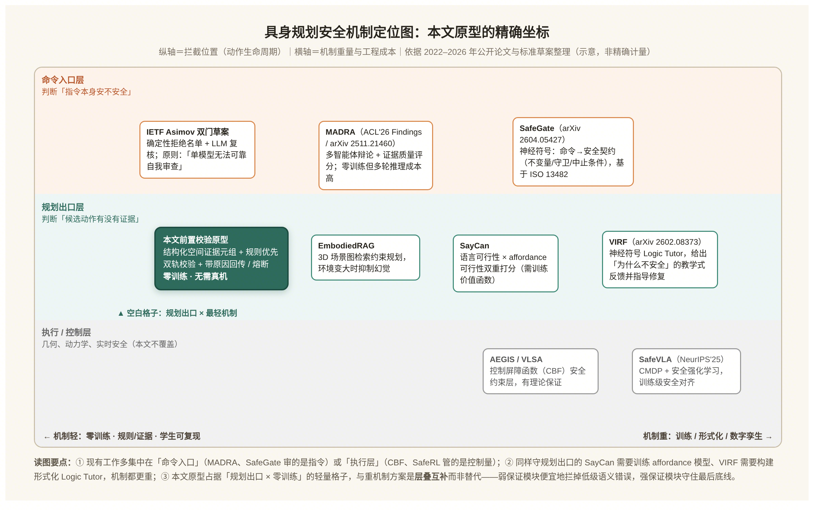

# 行之有据：一套轻量化切入具身智能的工程框架

> 系列总纲 · 第一篇 ｜ 探月具身智能社区 · 技术专栏
>
> 本文是本仓库的核心论述。文中所涉术语见 [terminology.md](terminology.md)，全部引用见 [references.md](references.md)。

**摘要**：具身智能落地有两道坎：数据昂贵、轻量化规划易出错。二者共享一个被忽视的瓶颈：物理世界的"经验"未被结构化、证据化。以图文多模态 RAG 工程实践为底座，提炼"一个底座、两个落点"框架：朝后看是**过程留证**，在数据入口把人的操作沉淀为任务级示教数据；朝前看是**动作举证**，在动作出口为机器人规划做零训练前置语义校验。成熟度：底座已工程跑通；采集前端完成原型迭代与成熟度分析，**尚未落地**；前置校验是**演示原型（demo）**，仅案例推演、未系统测试。本文不做算法创新，只讲工程范式、能力边界与上手路径。

## 引言：两道坎，一个被忽视的共同瓶颈

2026 年被称为"具身智能数据元年"，底色却是短缺。国金证券估算，训练出可用的具身模型至少需 1000 万小时多模态数据，全球积累不足需求的 5%[^1]；中国信通院判断：全球高质量真实数据仅数十万至百万小时级，基础模型迎来"ChatGPT 时刻"至少需数千万小时，缺口超 99%[^2]。

更致命的是"花钱也买不到可用数据"。36 氪 8 月调查：某公司买数据后一半人手清洗一个半月，有效率只剩 10%[^3]。**数据贵是第一道坎，"花了钱也未必能用"是更深的坎。**

第二道坎在动作出口。高校最流行的轻量方案是"VLM 写自由描述，LLM 一次性出动作"，会犯人类看来不可思议的错误：杯子被书本挡住仍规划去拿；自身与桌面参考系混淆、方向反掉；画面没有证据也敢出动作。2025 年研究称之为**阶段幻觉（stage hallucination）**——模型汇报"进展顺利"，任务其实没完成[^4]。

两道坎常被分开谈，二者**共享一个被忽视的瓶颈：物理世界的"经验"未被结构化、证据化。** 36 氪点破：第一视角数据"能告诉模型看到什么，却未必能告诉它为什么这样动、接触在哪、用多大力"[^3]——"哪步是关键决策、失败在哪一瞬"是一团混沌；出动作时有哪些空间证据没摆到模型面前，只能"凭感觉伸手"。需说明，数据短缺还有硬件成本、sim-to-real、标注标准等成因，动作错误也有几何、控制成因；证据化不是唯一根因，而是两条线上共同被忽视、软件侧可独立着手的瓶颈。

框架见图 1 与下方架构图：**一个底座，两个时间方向上的落点**。底座是图文多模态 RAG 沉淀、已工程验证的"证据化"方法论；朝后看的落点是**过程留证**，在数据入口把人的操作沉淀为任务级示教数据（采集前端，原型迭代、未落地）；朝前看是**动作举证**，在动作出口为规划做前置语义校验（演示原型、案例推演）。本文服务有软件工程能力、以物理世界为对象的开发者——无需真机即可开始。



---

## 一、底座：RAG 的真正遗产是"举证责任"

### 1.1 四个工程件

底座来自一套已跑通的图文多模态 RAG 实践，含四个工程件：

- **双链路并行解析**：文本分层清洗，图像降噪、OCR、语义结构化后统一向量化，不丢视觉信息；
- **父子双层分块**：子块命中细节，父块补全上下文，重叠分片防止知识点被切碎；
- **混合检索融合**：关键词命中术语参数，向量检索兜住语义相近的表达；
- **证据溯源**：每条结论强制绑定其依据的原始片段。

加拿大航空（Air Canada）聊天机器人**检索到正确的退赔政策，生成时却给出违背政策的回答**，最终担责（Moffatt v. Air Canada, 2024 BCCRT 149）[^5]——问题不在"不知道"，而在"知道但没用对"：检索正确不等于使用正确。

### 1.2 从"言之有据"到"行之有据"

抽象掉技术，四件工程件共做一件事：**给认知加举证责任——任何结论都必须能翻回其依据的原始片段。** 文本世界没证据的输出叫"胡说八道"，物理世界没证据的动作叫"轻举妄动"。二者同构：都用流畅生成掩盖证据缺位，区别只是代价从一句话到一次碰撞。

### 1.3 迁移要换掉的三个零件

处理对象从"文档图片"变成"连续操作流"，三个零件要重造：

1. **静态分块 → 动态触发**：操作录像大部分是空白重复，不能固定切分，要靠帧差捕获关键帧；
2. **文本证据 → 多源时序证据**：决策证据是"画面 + 语音 + 时间戳"三元组，缺一则还原不了现场；
3. **文档隐私 → 物理隐私**：对象是真人真环境，默认最小采集、本地处理。

换掉三个零件，底座就从"文档证据化"升级为"物理过程证据化"——框架枢纽，两个落点由此长出。

---

## 二、过程留证：让老师傅正常干活，教材自己长出来

### 2.1 三条采集路线，各自的账单

- **真机遥操作**：质量最高，但每条需数十秒采集，"数据昂贵"被列为行业三座大山之首[^6]；折损同样惊人——湖北人形机器人创新中心口径：训练师每天真机 8 小时，能用的仅两三小时[^7]；
- **仿真生成**：便宜量大，但 sim-to-real 鸿沟使摩擦、光照、材质稍变即失效；
- **众包真人视频**：门槛低、规模快，但手部出画、摆拍普遍，可用率长期低位[^3]。

第三条路的关键是：**视频不缺，缺的是从混沌录像里提炼"有效操作"的工序。** 共识正从"缺数据"转向"缺有效数据"[^3]，这正是证据化主场。

### 2.2 学术坐标：人类视频这条路已被走通

"拿人的操作教机器人"已有脉络：**MimicPlay（CoRL 2023）** 用人类视频学高层规划，底层只需少量遥操作数据[^8]；**EgoMimic（2025）** 用 AR 眼镜采集第一人称视频与配对 3D 手部追踪，并定制缩小人手运动学鸿沟的低成本双臂机械手[^9]；**EgoDex / HumanScale（2025）** 做到数百小时规模，发现过滤标注的人类视频预训练效果甚至可超过真机数据[^10][^11]。这条线证明可以"在旁边看大人干活"——前提是内容经过提炼。

### 2.3 方案与成熟度：低成本采集前端

方案起于一次集中原型开发，定位是手工创作者、硬件调试者的记录工具，内核是"示教数据采集前端"；原型阶段完成迭代与成熟度分析，**此后未继续开发、未落地、硬件不在手**，三条链路仍是**设计**：

- **低打断录入**：不必停手记笔记，图、视频、语音丢进"收件箱"，可手动"留一刻"、内置创作模板；
- **事实候选确认**：系统提炼候选、一键确认，避免自动结构化幻觉；
- **试错链组织**：内容按"问题 → 假设 → 调整 → 结果"串成实验条目，沉淀进实验库、关联物料。

帧差抽关键帧、画面 / 语音 / 时间戳绑定、空白过滤**是方案设计、尚未实现**，对应众包缺失的工序——按设计，人正常干活、数据骨架自动长出，无需摆拍或遥操作设备。

以 ESP32 调试走查说明预期形态：按复位键、看指示灯、把波特率从 115200 改到 9600；按设计，前端不打断操作即可捕获画面、语音（"哦，波特率错了"），试错链呈现为"无响应 → 怀疑波特率 → 改 9600 → 成功"，可检索（**设计走查，非实测**）。

### 2.4 一体两面

**对人**，它是创作谱系引擎，让调试失败经验可检索；**对机器人产业**，它是数据链上游的低成本采集前端，产出带任务结构、因果说明、失败标注的数据——服务人是经验工具，服务机器人是采集基础设施。

### 2.5 诚实边界：语义级到关节级隔着什么

方案面向**语义级 / 任务级数据**（操作序列、场景变化、试错链、任务描述），对任务规划、场景先验、难例沉淀有预期价值，但**还不是可训练的关节级数据**。人手 20 余个自由度加软组织形变，关节一一映射必然失败，通行做法是把重定向表述为优化问题、求最贴合人手功能意图的构型[^12]。**关节级数据是演进方向（3D 手部追踪、重定向、手眼标定），不是现状。** 真人数据涉及授权隐私，设计坚持最小采集、本地处理——伦理在采集端解决。

> *待检验：同源视频经证据化处理与否，下游规划成功率差多少？（数据对照篇，尚未开展，实验设计草案见 [02-数据侧对照.md](02-数据侧对照.md)）*

---

## 三、动作举证：动作出口前的"证据安全员"

### 3.1 典型病灶

主流轻量流水线把安全寄托在 Prompt 一句"小心障碍"，是软性约束。三类典型错误：**遮挡误判**（看不见当不存在）、**参考系混淆**（"左边"是谁的左边）、**证据不足强行规划**——都不是几何难题，而是"语义没过脑子"。

### 3.2 学术坐标：同期工作站在哪，差异是什么

把 2022–2026 年的工作按"**拦截位置 × 机制重量**"排开（图 2 与下方定位图）：

**守命令入口**：MADRA（ACL 2026 Findings）让多智能体辩论、批判者按"逻辑、风险、**证据质量**、清晰度"打分，约 90% 拒绝率并缓解"过度拒绝"，零训练但推理成本高[^13]；SafeGate（2026，预印本）依 ISO 13482 把命令分解为不变量、守卫、中止条件[^14]；IETF Asimov 双门草案用"确定性拒绝名单 + LLM 复核"，判断"**单个模型无法可靠自我审查**"[^15]。

**守规划出口**：SayCan 让"语言说有用"与"affordance 说可行"概率相乘才选动作[^16]；EmbodiedRAG 用 3D 场景图约束规划，环境变大后全记忆模式幻觉翻倍、证据检索模式不产生幻觉[^17]；VIRF（2026）让确定性"逻辑导师"指出计划为何不安全并指导修复，但需形式化模块[^18]。

**守执行层**：控制屏障函数、SafeVLA（NeurIPS 2025）保证最强，但依赖训练或形式化建模[^19]。

本文原型占据"**规划出口 × 最轻机制**"格子。差异不在"谁更安全"——它们保证更强——而在**组织原则的来源**：MADRA 来自辩论理论，SafeGate 来自形式化安全标准，VIRF 来自可验证逻辑；本文"每个候选动作必须出示空间关系元组作为证据"来自 **RAG 举证责任**而非安全工程，因而不需要多智能体交互、形式化分解或仿真基建，代价是只给语义级弱保证。旁证有二：MADRA 也把"证据质量"列为评分项；Asimov"单模型不可自我审查"与本文"规则优先于模型"的双轨设计独立同构。它不替代重机制，而是分层防御中最便宜的第一道。



### 3.3 演示原型：前置校验器

前置校验目前是**演示原型（demo，零训练，Prompt + 规则）**，三处改造：

1. **自由文本 → 结构化空间关系**。VLM 输出改为空间元组：实体、关系类型、参考坐标系、可信度、观测性质（亲眼所见/推测），后两者入结构，令模型先自我举证；
2. **单层推理 → 证据驱动规划 + 双轨校验**。候选动作必须有空间关系支撑；确定性规则硬拦截（如"目标遮挡 → 禁止抓取"），语义模型柔性复核，规则优先于模型；
3. **定向修正 + 熔断**。不通过时带原因回传（如"目标被遮挡，建议先移开"）；连续失败或证据不足即熔断——**承认"看不清、不能动"，比硬伸手安全。**

它像施工现场的安全员，不替工人干活、不做力学计算，只拿清单追问："你说墙后有杯子，亲眼看见了吗？没看见就不许伸手。"

以桌面遮挡的**案例推演**说明流转：VLM 输出"杯子可见、伸手可抓"；校验器发现"遮挡"字段缺失、无置信度，规则拦截并回传"书本遮挡目标，建议先移开"，规划改写为"先确认遮挡"。**此为人工推演、非批量测试；拦截率、误报率本文不做。** 上述规则的**可运行实现见本仓库 [src/semantic_checker/](../src/semantic_checker/README.md)**。

### 3.4 能力边界

安全员只管语义、不碰几何：**不做**三维重建、碰撞检测、运动学求解，毫米级误差与动力学碰撞超出范围，遇到即熔断交还几何 / 控制模块。目标是以极低成本拦掉"人类一眼看出蠢、模型却反复犯"的语义错误，抬高可靠性下限，效果待验证。

> *待检验：规则与语义模型的分工边界、熔断阈值、误报漏报如何权衡？（校验消融篇，尚未开展）*

---

## 四、同源与合流：为什么两个落点不是拼凑

两个落点本质是同一件事——**把连续、模糊的物理过程证据化，只是时间方向不同。** 采集前端面向**人的操作**、时间朝后，提炼留存经验，位于数据链路**入口**；校验器面向**机器人的动作**、时间朝前，要求动作先出示证据，位于规划链路**出口**——一个"事后让经验不流失"，一个"事前让动作有根据"。

两端共用同一种证据结构。证据单元（Evidence Unit）是贯穿采集与校验的最小载体——同一组字段，朝后看是留证原子、朝前看是举证载荷。下面只列五个核心字段示意（设计稿，值为示例，完整 schema 留待后续）：

```yaml
evidence_unit:
  id: eu_demo_0001
  source: [frame_0117.png, voice_0117.wav, "波特率不对，试试 9600"]  # 画面 + 语音 + 时间戳
  decision: "调整波特率为 9600"      # 关键决策：留证时从试错链抽取，举证时作先验
  confidence: 0.82                   # 示例值，非真实输出；观测性质（亲眼所见 / 推测）随字段标注
  fail_or_succeed: succeed           # 成败标注，供难例回流
```

证据单元不替代场景图、任务图或行为树，而是更轻的证据原子层：空间关系可挂载到场景图、任务分解可映射到行为树，接口后续展开。同一套 schema 支撑两个落点，是同源性的工程统一（设计稿，尚未在两条链路跑通），不止于概念对称。

产业语境下，这一结构意义更直接。2026 年上半年国内具身赛道融资约 935 亿元、同比增约 5 倍，投资逻辑正从"后空翻"演示转向"搬砖头"式交付[^20]。三条采集路线各自为战、标准不一，"物理过程证据化"能否充当跨路线的统一语义组织层，本文只提出一个**可检验假设**：无论数据来自哪条路线，都可能对齐到"操作序列 + 场景变化 + 试错因果链"的任务级格式。成立与否取决于两点：不同路线数据能否对齐、对齐后下游规划是否真有收益；方案目前只围绕自然操作一种来源设计，跨路线通用性与难例回流飞轮都是演进方向。

---

## 五、产品化：方案之后的 4 个问题

方案成立不等于产品成立，四个问题：

1. **谁用**：创作者 / 调试者 / 具身研发团队，对应两个方向
2. **凭什么用**："过程不白干、失败可复用"，而非堆参数
3. **凭什么敢用**：最小采集、本地处理、画面可控
4. **凭什么不打断**：低打断交互，不破坏心流

第四问是心流假设，不能自证，需用户研究检验（计划见路线图）。

以第四问为例，验证不需要完整产品：邀请数位创作者做半结构访谈加一周观察，记录"记录是否打断心流"与"当日记录条数、次周复用次数"，即可初验低打断假设；研究设计留待系列之四。

---

## 六、不同起点的开发者，从哪里切入

**只有笔记本和软件基础（学生 / 转行者）**，走 1→2→3 级：

| 阶段 | 做什么 | 最小交付物 | 真机 |
|---|---|---|---|
| 1 | 图文多模态 RAG：双链路解析、父子分块、混合检索、证据溯源 | 带来源的笔记问答库 | 否 |
| 2 | 物理过程记录：帧差抽帧 + 语音 / 时间戳绑定 + 试错链 | 一次手工 / 焊板 / 调试的结构化记录 | 否 |
| 3 | 语义前置校验：空间元组 + 规则校验 + 熔断 | 桌面图片上拦住"遮挡仍抓取"的校验器 | 否（仿真可选） |
| 4 | 进阶：手部追踪与重定向，接入仿真器或低成本机械臂 | 语义数据向动作数据的转换 Demo | 进阶需要 |

**已有仿真环境（研究生）**：从第 3 级直接切入，用 PyBullet、MuJoCo、Isaac Sim 批量生成截图与指令，测三类错误拦截率，无需真机训练，一两天出结果。**产业团队**：把第 2、3 级产出当作现有管线的"语义标注插件"，不替换既有流程，只在后处理加一道证据化步骤看下游规划是否提升。

---

## 七、局限、适用范围与展望

1. **路线局限**：本文是软件侧切入具身的路径，不覆盖端到端 VLA、纯三维几何、传统控制路线；
2. **能力局限**：语义校验不解决几何与动力学问题；采集前端当前只面向任务级数据，关节级能力依赖手部追踪与重定向工具链集成；
3. **成熟度局限**：**底座**四件工程件已在真实项目跑通，是唯一工程验证的部分；**采集前端**在原型阶段完成迭代与成熟度分析，此后未开发、未落地，帧差、三重绑定仍为方案设计；**前置校验**是演示原型，仅经案例推演，**没有测试集、拦截率或误报率数字**。原型成熟度不等于产业级可靠性。

展望两条：数据侧，手部追踪、重定向平民化（EgoMimic、UniDex 等推动）带动前端向关节级演进；可信侧，语义校验可与控制屏障函数、安全强化学习层叠部署——**弱保证模块便宜拦住低级错误，强保证模块守住底线**，是安全工程常识。

## 结语

具身智能不该有"没有机器人就入不了场"的门票。学界追算法上限、产业界磨整机下限时，还留着大片中间地带：经验怎么沉淀、动作怎么举证、失败怎么回流——这些问题不需要真机，只需把软件工程成熟的"证据化"思想搬到物理世界。记录让好经验不必重来，校验让坏动作不必发生。底座已验证，两个落点仍是方案与演示原型，结论留待后续。

---

**配图**：



图 1 框架总览图；



图 2 安全机制二维定位图。

**附：本系列路线图**

| 篇 | 主题 | 核心工程问题 | 主要交付 |
| --- | --- | --- | --- |
| 一（本文） | 总纲 | 经验证化的工程范式 | 已验证底座 / 采集前端方案 / 校验演示原型 |
| 二 | 数据侧对照 | 证据化处理能否提升下游规划成功率？ | 同源视频的 A/B 实验报告 |
| 三 | 校验层消融 | 规则与模型的分工、熔断阈值、同期对比 | 自建测试集 + 消融表 |
| 四 | 产品化调研 | 低打断交互对记录意愿的真实影响 | 创作者访谈 + 一周观察 |
| 五 | 飞轮方向 | 跨路线语义对齐 + 难例回流 | 最小可行飞轮设计 + 案例 |

## 参考资料

[^1]: 人民日报《机器人"喂不饱"，具身智能数据之困怎解》（引国金证券测算），2026-07：http://paper.people.com.cn/zgcsb/pc/content/202607/27/content_30171241.html
[^2]: 中国新闻周刊《缺口超过 99%，全国都在"火爆"上马》（引中国信通院《具身智能训练场研究报告（2026 年）》），2026-08：https://www.zgxwzk.chinanews.com/cover/2026-08-27/31754.shtml
[^3]: 36 氪《具身数采的"鬼故事"越来越多了》，2026-08-13：https://eu.36kr.com/zh/p/3937381590580615
[^4]: EvoVLA: Self-Evolving Vision-Language-Action Model, arXiv:2511.16166：https://www.alphaxiv.org/overview/2511.16166v1
[^5]: Moffatt v. Air Canada, 2024 BCCRT 149，不列颠哥伦比亚省民事裁决庭（Civil Resolution Tribunal）裁决原文，2024-02-14：https://decisions.civilresolutionbc.ca/crt/crtd/en/item/525448/index.do
[^6]: 麻省理工科技评论中国《从模仿到自主，机器人还需跨越三重挑战｜专访 NTU 王子为》，2025-11：https://wap.mittrchina.com/news/detail/15556
[^7]: 36 氪《AI 时代最容易被忽视的苦力活：给机器人"擦屁股"的人》（引湖北人形机器人创新中心口径），2026-09-17：https://36kr.com/p/3987416739003138
[^8]: D. Xu, *Robot Learning from Embodied Human Data* (MimicPlay, CoRL 2023 教程)：https://faculty.cc.gatech.edu/~danfei/corl24.pdf
[^9]: EgoMimic: Scaling Imitation Learning through Egocentric Video, 2025：https://egomimic.github.io/
[^10]: EgoDex: Learning Dexterous Manipulation from Large-Scale Egocentric Video, arXiv:2505.11709：https://arxiv.org/pdf/2505.11709
[^11]: HumanScale: Egocentric Human Video Can Outperform Real-Robot Data for Embodied Pretraining, 2026：https://www.semanticscholar.org/paper/ced42ebfae634bd46cba2c89c98a2c378bf0d3d6
[^12]: DexMV: Imitation Learning for Dexterous Manipulation from Human Videos (Qin et al., ECCV 2022，人手到灵巧手的运动重定向被表述为维持任务空间向量的优化问题)：https://dl.acm.org/doi/abs/10.1007/978-3-031-19842-7_33
[^13]: MADRA: Multi-Agent Debate for Risk-Aware Embodied Planning, ACL 2026 Findings / arXiv:2511.21460：https://aclanthology.org/2026.findings-acl.340/
[^14]: SafeGate: Pre-Execution Safety Gate & Task Safety Contracts, arXiv:2604.05427：https://arxiv.org/html/2604.05427v1
[^15]: IETF Internet-Draft, Asimov Safety Architecture (ASA)：https://www.ietf.org/archive/id/draft-baysal-asimov-safety-architecture-00.txt
[^16]: SayCan: Do As I Can, Not As I Say, Google, 2022：https://saycan.github.io/
[^17]: EmbodiedRAG: Dynamic 3D Scene Graph Retrieval for Robot Task Planning, arXiv:2410.23968：https://arxiv.org/html/2410.23968
[^18]: VIRF: Grounding Generative Planners in Verifiable Logic, arXiv:2602.08373：https://arxiv.org/html/2602.08373v1
[^19]: SafeVLA: Safety Alignment of VLA via Constrained Learning, NeurIPS 2025：https://proceedings.neurips.cc/paper_files/paper/2025/hash/e185c7be603426028c32ae1003a59d78-Abstract-Conference.html
[^20]: 证券时报《具身智能融资半年破 900 亿，投资逻辑从"后空翻"转向"搬砖头"》，2026-07（数据源：IT 桔子）：https://www.stcn.com/article/detail/4010046.html
