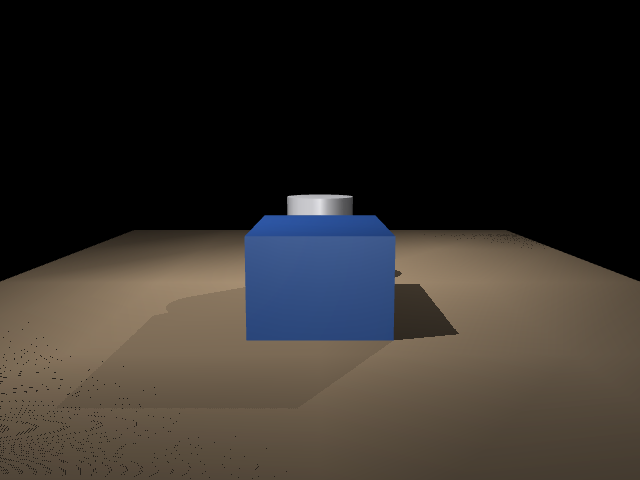
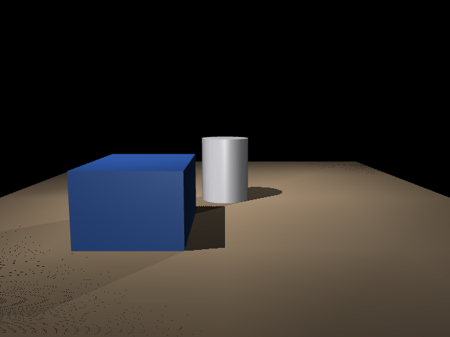

# 03 · 校验层消融：MuJoCo 遮挡场景上的仿真实验（第一版）

> 状态：**仿真实验初版已完成，感知侧为误差模型模拟，未接入真实 VLM。**
> 对应 [Roadmap](../README.md#roadmap) 第三篇的工程问题：规则与模型的分工边界、误报漏报如何权衡。

## 1. 要回答什么

[总纲](01-总纲-行之有据.md) 声称前置校验器能"以极低成本拦掉人类一眼看出蠢"的错误，但未给出任何数字。本实验先回答一个可测的子问题：

> **在遮挡场景中，零训练规则校验器的拦截率与误拦率，如何随"感知模型的自陈质量"变化？**

选择遮挡而非参考系/证据缺失，是因为遮挡有**几何真值**，可以脱离人工标注自动判定。

## 2. 方法

### 2.1 场景与几何真值

- 场景由 MJCF 基本几何体构成（桌面 + 圆柱杯子 + 盒状"一摞书"），不依赖外部网格资源，clone 即可复现；
- 相机绕杯子在 8 个方位角布置（距离 0.8 m、俯角 8°），书本放在 7 个方向偏移 × 3 个距离，共 **168 个场景**；
- 真值用射线判定：从相机向杯子表面 25 个采样点各发一条射线，若首命中体是杯子则该方向可见；**可见比例 < 0.5 判为遮挡**；
- 结果：遮挡 44 例 / 可见 124 例（比例 0：杯子被完全挡住；比例 1：完全可见）。

### 2.2 感知基线

真实 VLM 未接入。用两个可解释的基线替代：

| 基线 | 行为 |
|---|---|
| `OraclePerception` | 完美感知：真遮挡必报遮挡，可见则完整标注（用于检验规则本身不误拦） |
| `NoisyVLM(recall, honesty)` | 误差模型：漏检率 `1-recall`；漏检时自信声称"可见"；`honesty` 为不确定时如实标注字段的概率，不诚实时随机漏掉"观测性质"或"置信度" |

`NoisyVLM` 模拟的是当前轻量流水线的真实毛病：**没看清时不说没看清，而是自信地编一个描述。**

### 2.3 指标

- **TPR（拦截率）**：真遮挡场景中被拦下的比例；
- **FPR（误拦率）**：真可见场景中被拦下的比例；
- **漏放行数**：真遮挡却仍被放行执行的动作数（安全上最关心）。

## 3. 结果

| 遮挡漏检率 | 自陈诚实度 | TPR | FPR | 漏放行数 |
|---|---|---|---|---|
| 10% | 100% | 88.6% | 0.0% | 5 |
| 10% | 80% | 90.9% | 19.4% | 4 |
| 10% | 50% | 97.7% | 54.0% | 1 |
| 30% | 100% | 81.8% | 0.0% | 8 |
| 30% | 80% | 68.2% | 18.5% | 14 |
| 30% | 50% | 75.0% | 55.6% | 11 |
| 50% | 100% | 47.7% | 0.0% | 23 |
| 50% | 80% | 59.1% | 21.0% | 18 |
| 50% | 50% | 75.0% | 53.2% | 11 |

原始数据：[sim_metrics.csv](../experiments/sim_metrics.csv)；自动生成表：[sim_report.md](../experiments/sim_report.md)。

遮挡 / 可见示例（同一相机方位，仅书本位置不同）：

| 遮挡（可见比例 0） | 可见（可见比例 1） |
|---|---|
|  |  |

## 4. 三点发现

**发现一：模型愿意承认遮挡时，规则层是零成本收益。**
诚实度 100% 一行中，FPR 恒为 0，TPR 恰好等于 `1 - 漏检率`（88.6% / 81.8% / 47.7%）。也就是说：只要 VLM 如实报出"被遮挡"，规则层不再引入任何误拦，纯粹把漏检率削掉。

**发现二：校验器的安全收益，很大程度上是"把不确定性变成拦截"。**
诚实度从 100% 降到 50%，TPR 从 88.6% 升到 97.7%，代价是 FPR 从 0 升到 54.0%。规则并不能识别"自信的错误"——它识别的是**自陈字段的缺失与含糊**。这与总纲 FAQ Q2/Q3 的判断一致，也说明只加规则数量解决不了问题。

**发现三：瓶颈在结构化输出的可靠性，而不是规则数量。**
全部拦截都由 `R1_VISIBILITY` 触发，`R2/R3/R4` 在本实验的合成数据上没有出现。原因很直接：合成场景里证据永远存在、参考系永远给了值——真实流水线里这两条才是有用的。下一步应接入真实 VLM 输出，并强制结构化 schema（约束解码），把"漏字段"从常态变成异常。

## 5. 局限（务必与结论一起读）

- **感知侧是模拟的**：`NoisyVLM` 是误差模型，不是真实 VLM 的测量结果；本表不能当作"拦截率 88.6%"对外宣称；
- 场景是基本几何体的低保真近似，书本用盒体代替，不含材质、光照变化、遮挡物多样性；
- 只覆盖遮挡一类错误；参考系混淆、证据不足两类缺少可自动判定的真值，需人工标注或真实任务日志；
- 真值阈值 0.5 是工程约定，可见比例 0.48 的场景会被判为遮挡，边界样本的标签存在主观性；
- 未测延迟与算力开销（规则层为纯 Python，开销可忽略，但这不是实验测出来的）。

## 6. 复现

```bash
pip install -r requirements-sim.txt
python src/mujoco_eval/run.py            # 指标 -> experiments/
python src/mujoco_eval/run.py --render   # 额外渲染示例图 -> assets/sim/
python -m unittest discover -s src/mujoco_eval/tests -t src -v
```

代码：[scene.py](../src/mujoco_eval/scene.py)（场景）、[geometry.py](../src/mujoco_eval/geometry.py)（射线真值）、[perception.py](../src/mujoco_eval/perception.py)（感知基线）、[evaluate.py](../src/mujoco_eval/evaluate.py)（指标）、[run.py](../src/mujoco_eval/run.py)（入口）。

## 7. 下一步

1. 接入真实 VLM（同一批 168 张渲染图 + 统一 prompt），把误差模型换成实测；
2. 强制 JSON schema 输出，对比"自由文本 / 结构化输出"两种模式下 TPR、FPR 的差异——这是本实验最直接的后续假设；
3. 把场景扩展到多遮挡物、不同材质与光照，检验规则层是否仍然只依赖字段而不依赖外观。
