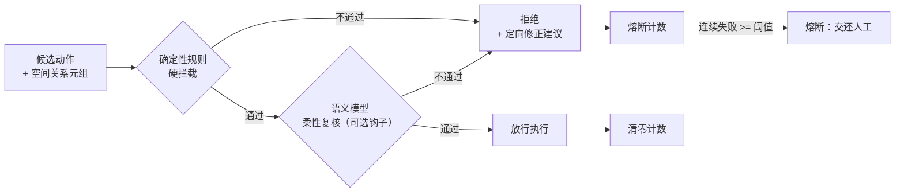

# semantic_checker · 零训练前置语义校验器

动作出口的"证据安全员"：不替工人干活、不做力学计算，只拿清单追问——"你说墙后有杯子，亲眼看见了吗？没看见就不许伸手。"

对应[总纲](../../docs/01-总纲-行之有据.md) 3.3 节的三处改造：

1. **自由文本 → 结构化空间关系**：实体、关系类型、参考坐标系、可信度、观测性质（亲眼所见/推测）全部入结构，令模型先自我举证；
2. **单层推理 → 双轨校验**：确定性规则硬拦截 + 语义模型柔性复核（可注入的钩子），规则优先于模型；
3. **定向修正 + 熔断**：拦截必带原因与改写建议；连续失败达阈值即熔断，交还人工。

## 双轨校验流程



## 规则清单（全部确定性，零训练）

| 规则 | 拦截什么 | 对应病灶 |
|---|---|---|
| `R1_VISIBILITY` | 目标被遮挡；可见性缺观测性质/置信度字段；可见性为推测 | 遮挡误判（看不见当不存在） |
| `R2_REFERENCE_FRAME` | 方向性关系（左/右/后/下）未声明参考坐标系 | 参考系混淆（"左边"是谁的左边） |
| `R3_EVIDENCE_SUFFICIENCY` | 候选动作没有与目标相关的证据 | 证据不足强行规划 |
| `R4_CONFIDENCE` | 目标证据置信度全部低于阈值（默认 0.5，可配） | 低可信证据强行规划 |

## 运行

```bash
# 演示（六个用例 + 熔断流程）
python src/semantic_checker/demo.py

# 单元测试（零依赖，标准库即可）
python -m unittest discover -s src/semantic_checker/tests -t src -v
# 或（装有 pytest 时）
pytest src/semantic_checker/tests -q
```

零第三方依赖，Python >= 3.8。

## 用法

```python
from semantic_checker import SemanticChecker, parse_action

# 阶段一：文本模拟（正则把指令解析成空间元组，解析不到的字段留空）
action = parse_action("杯子被书本挡住了，抓取杯子")
verdict = SemanticChecker().check(action)
print(verdict)   # [规则拦截] 目标「杯子」被遮挡（遮挡物：书本），禁止执行 grasp | 修正建议：先移开遮挡物「书本」...

# 接入真实 VLM/LLM 时：直接构造 ActionCandidate，并注入柔性复核钩子
# SemanticChecker(llm_recheck=lambda action: (ok, reason))
```

## 阶段二计划（MuJoCo 仿真）

- 基于 MuJoCo 官方示例搭建桌面场景（杯子 + 书本）；
- 批量渲染不同遮挡/非遮挡配置的截图，用 VLM 生成候选动作；
- 统计校验器对"遮挡目标仍抓取"的拦截率与误报率，输出可复现实验脚本；
- 结果与[第三篇校验层消融](../../README.md#roadmap)共用一套测试集。

## 已知边界

- 只管语义、不碰几何：不做三维重建、碰撞检测、运动学求解；
- 阶段一解析器刻意保持"笨"（词面映射、不做推断），用于验证"字段缺失可被确定性发现"这一核心逻辑，不代表真实 VLM 输出质量；
- 拦截率/误报率尚无数字，请勿在任何安全关键场景使用。
